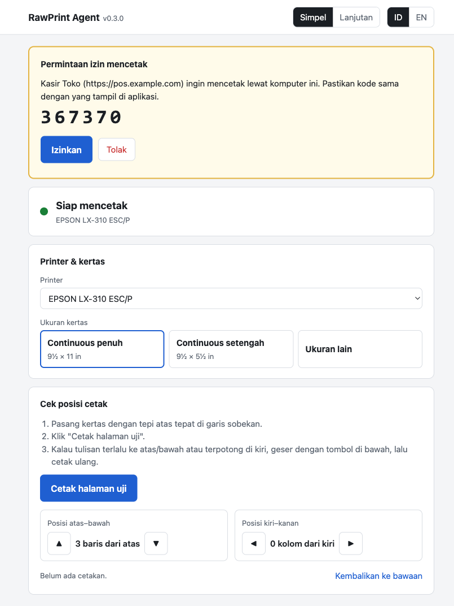

# RawPrint Agent

[Bahasa Indonesia](./README.md) | **English**

Print **RAW** data (ESC/P, ESC/POS, ZPL) from a web application straight to a printer on the user's PC, with no print dialog and no PDF. Built for dot matrix printers such as the Epson LX-310 on continuous form paper, so output is sharp, fast, and always in the same position.

[](https://go.dev)
[](./docs/installation.md)
[](./docs/api.md)
[](./LICENSE)
[](https://github.com/rizalahmaddd/raw-print-agent/releases/latest/download/RawPrintAgent-Setup.exe)



```
web app (browser) ── fetch ──▶ http://127.0.0.1:18310 ── RAW ──▶ Windows spooler ──▶ printer
```

---

## Features

### Printing
- **No print dialog:** the web app sends the data and the printer prints it.
- **Unchanged data:** bytes are forwarded as they are, and layout stays in your application.
- **No double prints:** the same `job_id` within 10 minutes does not print again, unless the earlier job failed.
- **Job status:** queued, printing, done, or failed (for example, out of paper), read from the Windows spooler.

### Always ready
- **Automatic start:** runs as a Windows service from the moment the PC starts, with no login needed. It can be turned off in the settings page.
- **Self-recovery:** the service starts again if it fails, for example when the port is busy at boot.
- **No dependencies:** one program file for Windows 10/11, 64-bit and 32-bit.

### Security
- **Local only:** the agent listens on loopback and cannot be reached from the network.
- **Per-app permission:** web origins must be allowlisted, then approved with a pairing code.
- **Origin-bound tokens:** a leaked token cannot be used from another site.

### Settings page
- **Simple mode** for operators and **advanced mode** for IT, in Indonesian and English.
- **Calibration:** print a test page, then move the print position with buttons.
- **Per-printer paper profiles** that your application can read to lay out documents.

## Installation

Download and run **[RawPrintAgent-Setup.exe](https://github.com/rizalahmaddd/raw-print-agent/releases/latest/download/RawPrintAgent-Setup.exe)**, then follow the wizard. Upgrading works the same way, and settings and pairings are kept.

Bulk installs, driver setup, and troubleshooting are in the [Installation Guide](./docs/installation.md).

## Print from a web page

Copy [`clients/js/rawprint.js`](./clients/js/rawprint.js) into your application. It has no dependencies.

```html
<script src="rawprint.js"></script>
<script>
const agent = new RawPrint({ appName: 'Store POS' });

async function printDoc(jobId, dataBase64) {
  const h = await agent.detect();
  if (!h.running) return alert('Install RawPrint Agent first');
  if (!h.paired) {
    await agent.pair((code) => alert('Approve code ' + code + ' in RawPrint Agent settings'));
  }
  const { job } = await agent.print({ jobId, dataBase64, docName: jobId });
  return agent.waitJob(job.job_id);
}

printDoc('invoice-123', btoa('\x1b@Hello from RawPrint\r\n\f'));
</script>
```

Your application's origin must already be registered in the agent. Details are in the [HTTP API](./docs/api.md) docs.

For Laravel, use the separate [laravel-rawprint](https://github.com/rizalahmaddd/laravel-rawprint) package: render ESC/P from Blade, pair automatically in the browser, or send directly when Laravel and the printer run on the same PC. Once published to Packagist, install it with `composer require rizalahmaddd/laravel-rawprint`.

## Documentation

These documents are currently available in Indonesian only.

| Document | Contents |
|---|---|
| [Installation Guide](./docs/installation.md) | Bulk installs, printer drivers, automatic start, troubleshooting, and CLI |
| [HTTP API](./docs/api.md) | Access rules, pairing, printing, and job status |
| [Development Setup](./docs/getting-started.md) | Running and building the agent from source |
| [Architecture](./docs/architecture.md) | Folder structure, print flow, and security rules |

## Contributing

Pull requests and bug reports are welcome. Read [CONTRIBUTING.md](./CONTRIBUTING.md) first. Report security issues privately as described in [SECURITY.md](./SECURITY.md).

## License

Released under the [MIT license](./LICENSE).

## Contact

Made by [@rizalahmaddd](https://github.com/rizalahmaddd). Need help or customization?

- WhatsApp: [+62 857-7777-5477](https://wa.me/6285777775477)
- Website: [solusikoding.com](https://solusikoding.com)
