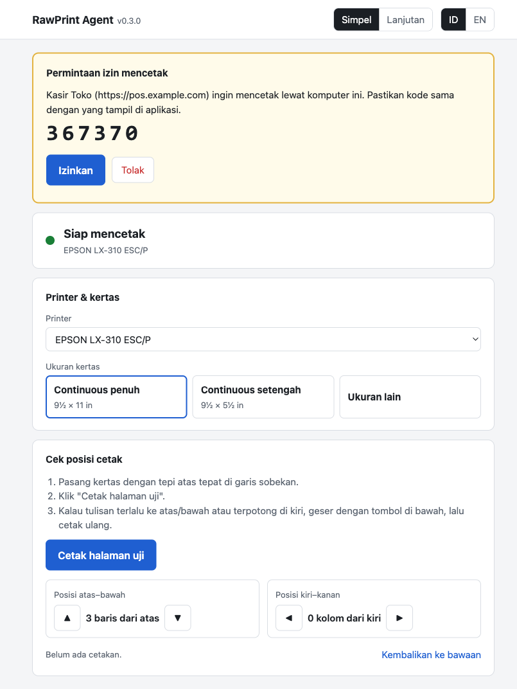

# RawPrint Agent

**Bahasa Indonesia** | [English](./README.en.md)

Cetak data **RAW** (ESC/P, ESC/POS, ZPL) dari aplikasi web langsung ke printer di PC pengguna, tanpa dialog print dan tanpa PDF. Dibuat untuk printer dot matrix seperti Epson LX-310 di kertas continuous form, agar hasil cetak tajam, cepat, dan posisinya selalu sama.

[](https://go.dev)
[](./docs/installation.md)
[](./docs/api.md)
[](./LICENSE)
[](https://github.com/rizalahmaddd/raw-print-agent/releases/latest/download/RawPrintAgent-Setup.exe)



```
aplikasi web (browser) ── fetch ──▶ http://127.0.0.1:18310 ── RAW ──▶ Windows spooler ──▶ printer
```

---

## Fitur

### Cetak
- **Tanpa dialog print:** aplikasi web mengirim data, printer langsung mencetak.
- **Data tidak diubah:** byte diteruskan apa adanya, tata letak tetap diatur aplikasimu.
- **Anti cetak ganda:** `job_id` yang sama dalam 10 menit tidak dicetak lagi, kecuali job sebelumnya gagal.
- **Status job:** antre, mencetak, selesai, atau gagal (misalnya kertas habis) dibaca dari Windows spooler.

### Selalu siap
- **Jalan otomatis:** berjalan sebagai service Windows sejak PC menyala, tanpa perlu login. Bisa dimatikan di halaman pengaturan.
- **Pulih sendiri:** service menyala lagi kalau gagal, misalnya saat port sedang terpakai ketika booting.
- **Tanpa dependensi:** satu file program untuk Windows 10/11, 64-bit dan 32-bit.

### Keamanan
- **Hanya lokal:** agent hanya mendengarkan di loopback, tidak bisa diakses dari jaringan.
- **Izin per aplikasi:** origin web harus masuk allowlist, lalu disetujui lewat kode pairing.
- **Token terikat origin:** token yang bocor tidak bisa dipakai dari situs lain.

### Halaman pengaturan
- **Mode simpel** untuk operator dan **mode lanjutan** untuk IT, tersedia dalam Bahasa Indonesia dan Inggris.
- **Kalibrasi:** cetak halaman uji, lalu geser posisi cetak dengan tombol.
- **Profil kertas per printer** yang bisa dibaca aplikasimu untuk menyusun dokumen.

## Instalasi

Unduh dan jalankan **[RawPrintAgent-Setup.exe](https://github.com/rizalahmaddd/raw-print-agent/releases/latest/download/RawPrintAgent-Setup.exe)**, lalu ikuti wizard-nya. Upgrade caranya sama, pengaturan dan pairing tetap tersimpan.

Instalasi massal, pengaturan driver, dan solusi masalah ada di [Panduan Instalasi](./docs/installation.md).

## Cetak dari halaman web

Salin [`clients/js/rawprint.js`](./clients/js/rawprint.js) ke aplikasimu. File ini tanpa dependensi.

```html
<script src="rawprint.js"></script>
<script>
const agent = new RawPrint({ appName: 'Kasir Toko' });

async function cetak(jobId, dataBase64) {
  const h = await agent.detect();
  if (!h.running) return alert('Pasang RawPrint Agent terlebih dahulu');
  if (!h.paired) {
    await agent.pair((code) => alert('Setujui kode ' + code + ' di pengaturan RawPrint Agent'));
  }
  const { job } = await agent.print({ jobId, dataBase64, docName: jobId });
  return agent.waitJob(job.job_id);
}

cetak('invoice-123', btoa('\x1b@Halo dari RawPrint\r\n\f'));
</script>
```

Origin aplikasimu harus sudah terdaftar di agent. Detailnya ada di [HTTP API](./docs/api.md).

Untuk Laravel, gunakan package terpisah [laravel-rawprint](https://github.com/rizalahmaddd/laravel-rawprint): render ESC/P dari Blade, pairing otomatis di browser, atau kirim langsung saat Laravel dan printer ada di PC yang sama. Setelah dirilis ke Packagist, pasang dengan `composer require rizalahmaddd/laravel-rawprint`.

## Dokumentasi

| Dokumen | Isi |
|---|---|
| [Panduan Instalasi](./docs/installation.md) | Instalasi massal, driver printer, jalan otomatis, solusi masalah, dan CLI |
| [HTTP API](./docs/api.md) | Aturan akses, pairing, cetak, dan status job |
| [Memulai Development](./docs/getting-started.md) | Menjalankan dan membangun agent dari source |
| [Arsitektur](./docs/architecture.md) | Struktur folder, alur cetak, dan aturan keamanan |

## Berkontribusi

Pull request dan laporan bug sangat diterima. Baca [CONTRIBUTING.md](./CONTRIBUTING.md) dulu. Celah keamanan dilaporkan secara privat sesuai [SECURITY.md](./SECURITY.md).

## Lisensi

Dirilis di bawah [lisensi MIT](./LICENSE).

## Kontak

Dibuat oleh [@rizalahmaddd](https://github.com/rizalahmaddd). Butuh bantuan atau kustomisasi?

- WhatsApp: [+62 857-7777-5477](https://wa.me/6285777775477)
- Website: [solusikoding.com](https://solusikoding.com)
